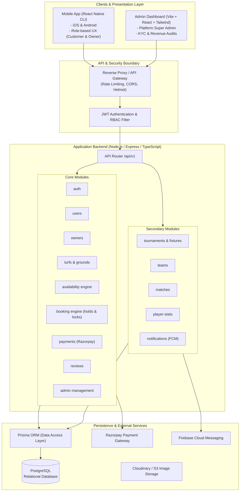

# System Architecture — Turf Booking Platform

## 1. Executive Summary

The Turf Booking Platform is a production-grade sports arena discovery and slot reservation marketplace (akin to BookMyShow for sports turfs). It bridges customers looking for verified sports grounds with turf owners managing multiple venues, individual grounds, dynamic pricing, and slot schedules. It also lays the architectural foundation for tournament brackets and player performance analytics.

---

## 2. High-Level Architecture Diagram

---

## 3. Monorepo Organization

The project is structured as a unified monorepo using standard **npm workspaces**, eliminating version mismatches between client contracts and backend models:

- `apps/mobile`: React Native CLI mobile application with role-aware bottom navigation.
- `apps/admin`: React 18, Vite, and Tailwind CSS responsive administration console.
- `apps/api`: Modular, service-oriented Express.js REST API with Prisma and Zod.
- `packages/shared-types`: Canonical TypeScript interfaces, enums, and API shapes.
- `packages/validation`: Single source of truth for runtime validation schemas using Zod.
- `packages/config`: Platform constants (fees, GST, timeouts, brand design tokens).
- `packages/api-client`: Standardized Axios wrapper with Bearer token injection and error handling.

---

## 4. Key Architectural Patterns

### 4.1. Separation of Concerns (Service-Oriented Modules)
Every backend module strictly separates responsibilities:
1. **Routes (`*.routes.ts`)**: Defines endpoints, binds authentication and role guards, attaches Zod validation middleware.
2. **Controller (`*.controller.ts`)**: Parses HTTP requests, extracts parameters, delegates to the service, and serializes responses using standard response helpers. No business logic resides in controllers.
3. **Service (`*.service.ts`)**: Encapsulates core business rules, transactional database operations, price calculations, and external gateway calls.
4. **Data Access**: Mediated exclusively via **Prisma Client** and PostgreSQL transactions.

### 4.2. Concurrency-Safe Booking Engine
Double-booking is prevented using database transactions (`prisma.$transaction`) and 10-minute temporary holds:
- Before any payment is initiated, the slot is placed on `HOLD` with a strict `expiresAt` timestamp.
- Slot queries check for overlapping `CONFIRMED` bookings as well as unexpired `HOLD` records.
- Stale holds are automatically cleaned up during slot checks and booking creation.

### 4.3. Unified Role-Based Routing
The mobile client uses a single code repository to serve both customers and turf owners:
- A root navigation controller inspects the user's role stored in Zustand state.
- Customers access venue discovery, availability slots, booking history, and personal profile.
- Turf owners are redirected to their operational dashboard, daily ground schedules, earnings ledger, and ground manager.
