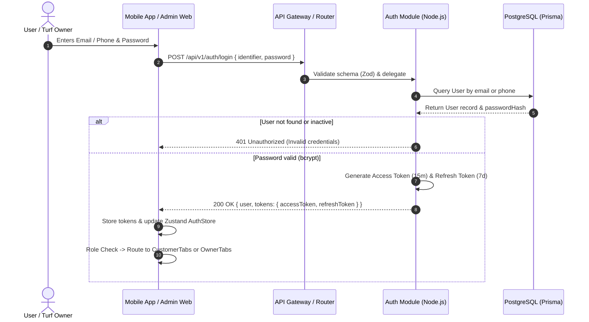
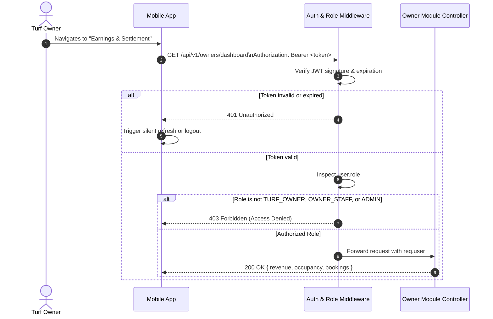

# Authentication & Authorization Flow — Turf Platform

## 1. Overview

The platform uses **Stateless JSON Web Tokens (JWT)** with dual-token architecture:
- **Access Token**: Short-lived (15 minutes). Sent in every API request header.
- **Refresh Token**: Long-lived (7 days). Stored securely (Keychain / Keystore on mobile, HttpOnly cookie or secure storage on web) to obtain new access tokens without forcing re-login.

---

## 2. Authentication Sequence Diagram

---

## 3. Role-Based Access Control (RBAC) Flow

---

## 4. Key Security Measures
- **Password Hashing**: Strong bcrypt salt rounds (10) ensure credentials are never stored in clear text.
- **Payload Minimization**: JWT payloads contain only non-sensitive claims (`userId`, `email`, `role`).
- **Server-Side Enforcement**: Frontend route hiding is purely for user experience; backend middleware (`authenticate`, `requireRoles`) independently validates every protected route.
- **Deactivated Account Revocation**: The authentication service checks `user.isActive` before issuing session tokens.
