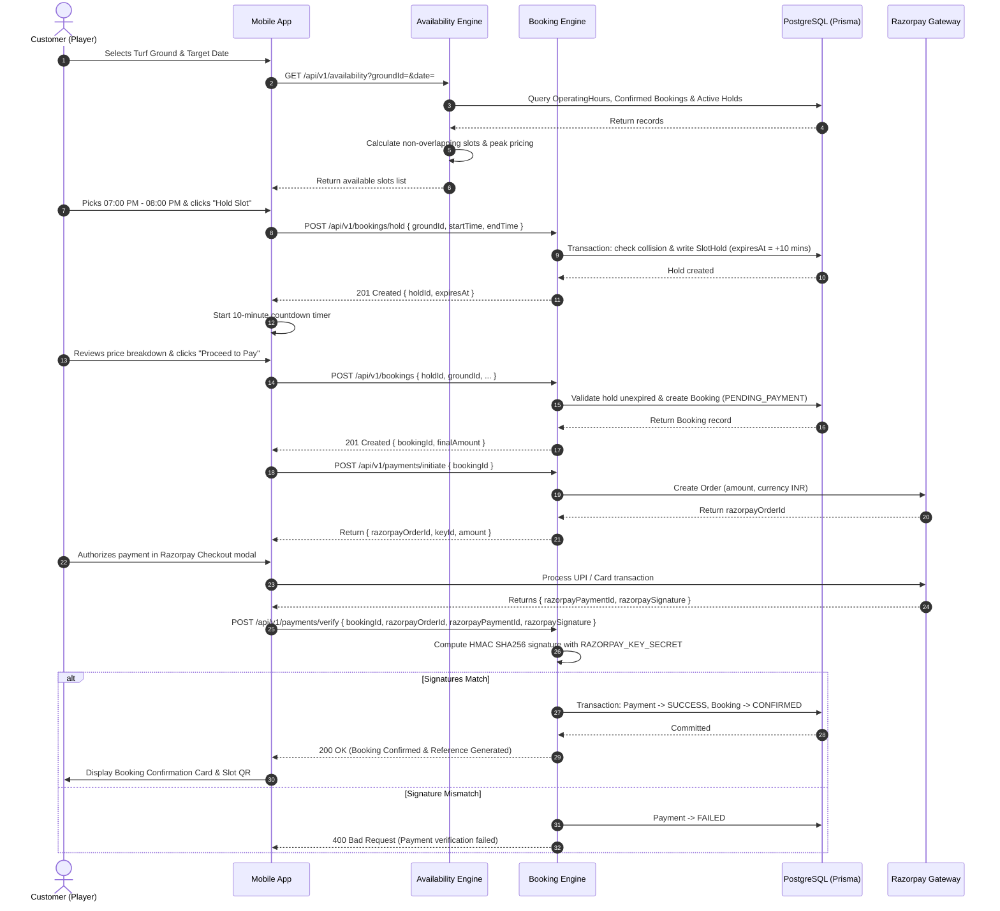

# Booking Engine & Payment Flow — Turf Platform

## 1. Overview

The booking engine is the core business process of the platform. It enforces:
- Real-time availability calculation based on venue operating hours.
- Variable peak-hour pricing.
- Concurrency protection preventing double-booking of any ground slot.
- Atomic temporary slot holds (10 minutes).
- Server-side Razorpay payment verification using HMAC SHA256.

---

## 2. End-to-End Booking Lifecycle Diagram

---

## 3. Concurrency Protection Strategy

1. **Database Transaction (`prisma.$transaction`)**:
   During hold acquisition, a read-lock and collision check is performed atomically. No two sessions can hold the same ground interval simultaneously.
2. **Hold Expiration (`expiresAt`)**:
   Holds automatically expire after 10 minutes. Any active query for availability filters out expired holds, instantly releasing abandoned slots back to the public pool without requiring manual release jobs.
3. **Double-Booking Shield**:
   When confirming payment, the system verifies that the booking status is `PENDING_PAYMENT` and that no overlapping `CONFIRMED` booking exists.
