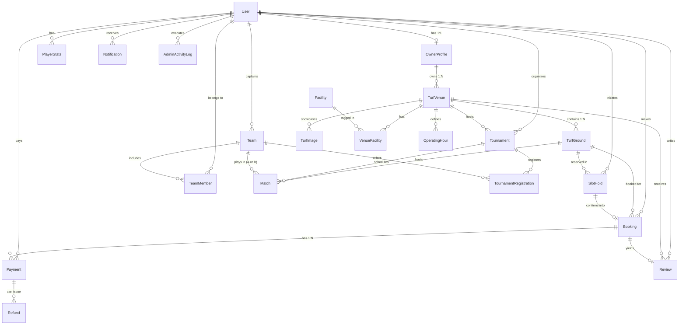

# Database Schema & Entity Relationship — Turf Booking Platform

## 1. Overview

The platform uses a relational PostgreSQL database managed via **Prisma ORM**. The data model is optimized for high-concurrency booking integrity, multi-venue ownership, independent ground configurations, and decoupled payment tracking.

---

## 2. Entity Relationship Diagram (ERD)

---

## 3. Core Database Entities

### 3.1. User & Identity
- `User`: Central identity record holding login credentials (`passwordHash`), verified contact details (`email`, `phone`), and primary role (`CUSTOMER`, `TURF_OWNER`, `OWNER_STAFF`, `TOURNAMENT_ORGANIZER`, `PLATFORM_ADMIN`, `PLATFORM_SUPER_ADMIN`).
- `OwnerProfile`: 1:1 relation with `User` containing business registration details, GSTIN, PAN, and bank account credentials for Razorpay route/settlement.

### 3.2. Venues & Grounds
- `TurfVenue`: Physical commercial establishment (e.g., "Apex Sports Arena, Koramangala"). One owner can have multiple venues.
- `TurfGround`: Specific playable unit inside a venue (e.g., "Ground 1 (7v7 Football)", "Court 3 (Badminton)").
  - Has its own sports list (`SportType[]`), surface material (`SurfaceType`), hourly base price, peak-hour surcharge, and customizable slot duration (typically 60 mins).
- `OperatingHour`: Day-of-week operating hours (`openTime`, `closeTime`, `isClosed`) for slot availability calculations.
- `Facility` & `VenueFacility`: Normalized amenities (Floodlights, Parking, Changing Rooms, Drinking Water, Turf Cleats Rental).

### 3.3. Booking Engine & Concurrency
- `SlotHold`: High-velocity temporary lock table. When a user selects an available slot, a record is written with an expiration timestamp (`expiresAt = now() + 10 mins`). This prevents concurrent users from checking out the exact same ground slot.
- `Booking`: The official reservation record. Once created, its status transitions from `PENDING_PAYMENT` to `CONFIRMED` upon webhook/signature validation. Contains `bookingReference`, exact datetime boundaries, and itemized monetary values (`totalAmount`, `convenienceFee`, `taxAmount`, `finalAmount`).
- `Payment`: Decoupled from the booking record. Tracks third-party transaction references (`razorpayOrderId`, `razorpayPaymentId`, `razorpaySignature`) and state transitions (`INITIATED`, `SUCCESS`, `FAILED`, `REFUNDED`).
- `Refund`: Audit record of full or partial refunds linked to specific payment IDs.

### 3.4. Tournaments & Performance
- `Tournament`: Organized competition associated with a sport, format (Knockout/League), entry fee, and prize pool.
- `Team` & `TeamMember`: Teams formed by captains and joined by players.
- `Match`: Fixture between two teams on a designated turf ground with status (`SCHEDULED`, `LIVE`, `COMPLETED`) and scores.
- `PlayerStats`: Aggregated user athletic history (matches played, won, goals/runs, MVPs) broken down by sport.
