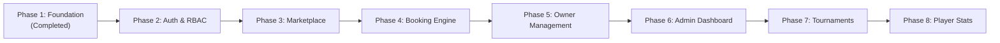

# Development Roadmap & Implementation Phases

## 1. Overview

Development is divided into 8 structured phases, prioritizing the primary booking product before secondary modules (tournaments and player statistics) are introduced.

---

## 2. Phase Breakdown

### PHASE 1 — FOUNDATION *(Completed)*
- Establish monorepo structure using standard npm workspaces.
- Configure root TypeScript compiler, Prettier, and ESLint policies.
- Scaffold shared packages: `@turf/shared-types`, `@turf/validation`, `@turf/config`, `@turf/api-client`.
- Author complete PostgreSQL schema in Prisma with relations and indexes.
- Scaffold Express.js backend API with modular service architecture and 15 domain modules.
- Scaffold React Native mobile app with role-based navigation (Customer & Owner tabs).
- Scaffold Vite + React + Tailwind admin web console with executive layouts.
- Generate complete architecture and system design documentation.

### PHASE 2 — AUTHENTICATION & PROFILES
- Customer mobile registration with OTP/phone and email.
- Turf owner onboarding with business profile.
- JWT token refresh flow and interceptors in `@turf/api-client`.
- Role verification guards on backend endpoints.
- User profile editing and password recovery.

### PHASE 3 — TURF DISCOVERY & MARKETPLACE
- Geolocation-based venue query with radius filtering.
- Sport category filters (Cricket, Football, Badminton, etc.).
- Venue photo gallery and amenity icons.
- Ground details with dimensions, turf surface type, and rules.
- Search with autocomplete by venue name, city, or locality.

### PHASE 4 — HIGH-CONCURRENCY BOOKING ENGINE
- Availability engine computing slots from operating hours and bookings.
- Temporary 10-minute slot holding with automatic expiration.
- Concurrency locks preventing double booking.
- Razorpay order generation and client-side modal checkout.
- Server-side HMAC SHA256 signature verification.
- Booking confirmation with unique reference code (`TRF-XXXXXX`).
- Cancellation window policy and automated refund calculation.

### PHASE 5 — TURF OWNER MANAGEMENT
- Owner operational dashboard on mobile.
- Multi-venue and ground management.
- Custom slot duration and peak-hour pricing rules.
- Real-time today's ground schedule for staff.
- Daily and monthly revenue ledger with bank settlement tracking.

### PHASE 6 — PLATFORM ADMINISTRATION
- Admin web console deployed on Vite + Tailwind.
- Turf venue approval queue (KYC, address verification, pitch inspection).
- Global booking monitoring and dispute resolution.
- Dynamic commission percentage and fee settings.
- Financial reports exportable to CSV.

### PHASE 7 — TOURNAMENTS & FIXTURES *(Secondary Module)*
- Tournament creation with format rules (Knockout / League).
- Team registration with entry fee collection.
- Automated fixture bracket generator.
- Match scheduling on partner turf grounds.
- Live score updating and points table.

### PHASE 8 — PLAYER STATISTICS & SOCIAL *(Secondary Module)*
- Player career profiles across sports.
- Win/loss records, goals scored, runs made, MVP awards.
- City and venue player leaderboards.
- Push notifications via Firebase Cloud Messaging for match reminders.
